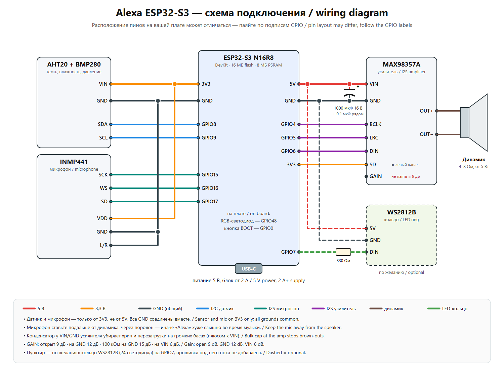

# 🔊 DIY "Alexa" smart speaker on ESP32-S3

[Русская версия](README.md)

A voice speaker built on a single ESP32-S3 board. Say "Alexa", ask a question, and it answers out loud. The assistant speaks Russian by default; change the prompts to switch the language. No home server is needed: everything runs on the board itself. It also plays internet radio and Spotify, keeps timers and alarms, measures temperature, humidity and pressure, and can be controlled from a web page and from Telegram.

<!-- Add a photo here:  -->

## Features

- 🗣 **Voice assistant.** The on-device wake word "Alexa" uses esp-sr, then one of two modes:
  - **Gemini Live**: real-time conversation, you can interrupt and follow up;
  - **Groq** (Whisper + LLM) with Google Cloud TTS voice and web search.
- 🌦 **Weather station.** AHT20 + BMP280 sensors, 14-day charts, pressure-trend forecast, Open-Meteo weather. Spoken warnings for dry or damp air, cold, heat and pressure drops.
- 📻 **Internet radio.** Station list, search via radio-browser.info, voice volume control.
- 🎵 **Spotify** through a PC bridge (Spotify Connect), see below.
- ⏰ **Timers and alarms**, including a music alarm that ramps the volume up after a morning brief.
- 🌙 **"Good night" mode.** Quieter voice, LED off, a sleep timer that fades the music out, and the mode turns itself off in the morning.
- 🌐 **Web UI** at `http://meteo.local`: controls, settings, charts, log, firmware update.
- ✈ **Telegram bot** running on the board itself, with buttons: status, music, volume, night mode, "say aloud", ask the assistant, and firmware update by sending a .bin. Works from anywhere, no PC needed.
- 📶 **Wi-Fi setup from a phone.** If the speaker can't find its network, it opens an **"Alexa-Setup"** access point with a captive portal. Handy if you give it as a gift.
- 🔄 **OTA updates** from the Arduino IDE, the `/update` page or Telegram.

## Parts

| Part | Notes |
|---|---|
| ESP32-S3 N16R8 DevKit | 16 MB flash, 8 MB PSRAM (OPI PSRAM required) |
| MAX98357A | I2S amplifier, 5 V supply |
| Speaker, 4–8 Ω | 5 W or more; the MAX98357A gives about 3 W |
| INMP441 | I2S microphone |
| AHT20 + BMP280 | 2-in-1 I2C module |
| 1000 µF 16 V + 0.1 µF capacitors | on the amp supply, against distortion and brown-outs |
| USB power supply, 5 V 2 A+ | |
| *WS2812B ring (optional)* | for later, GPIO7 |

## Wiring



| Module | Module pin | ESP32-S3 |
|---|---|---|
| AHT20 + BMP280 | VIN / GND / SDA / SCL | 3V3 / GND / GPIO8 / GPIO9 |
| INMP441 | VDD / GND / SCK / WS / SD / L/R | 3V3 / GND / GPIO15 / GPIO16 / GPIO17 / GND |
| MAX98357A | VIN / GND / BCLK / LRC / DIN | 5V / GND / GPIO4 / GPIO5 / GPIO6 |
| MAX98357A | SD | 3V3 (left channel) |
| MAX98357A | GAIN | leave open (9 dB) |
| On-board RGB LED | | GPIO48 |
| BOOT button | | GPIO0: press to ask; hold 10 s for Wi-Fi setup |

Tips:
- Keep the microphone away from the speaker, ideally mounted on foam.
- All grounds are common.
- The sensor and the microphone run on 3V3 only.

## Flashing

1. **Arduino IDE 2** with the **esp32 by Espressif** core 3.x.
2. Libraries (from the Library Manager):
   - Adafruit AHTX0;
   - Adafruit BMP280 Library;
   - ArduinoJson;
   - ESP32-audioI2S (schreibfaul1).
3. Open `aht20_bmp280/aht20_bmp280.ino`. The default weather city is Kyiv. To use yours, change `WEATHER_LAT` and `WEATHER_LON` in `assistant.h`, and the city name ("в Киеве") in the prompts in `assistant.h` and `gemini_live.h`.
4. Optionally, copy `secrets.example.h` to `secrets.h` and fill in your Wi-Fi and passwords. Without it, Wi-Fi is set up through "Alexa-Setup". The default `/update` login is `admin` / `alexa`; change it.
5. Board settings:
   - **ESP32S3 Dev Module**;
   - Flash Size **16MB**;
   - PSRAM **OPI PSRAM**;
   - USB CDC On Boot **Enabled**;
   - Partition Scheme **16M Flash (3MB APP/9.9MB FATFS)**. The sketch's own `partitions.csv` is what actually gets used.
6. Flash the first time **over USB**.
7. Flash the "Alexa" wake-word model `srmodels_alexa.bin`. This is done once; see [README_wakeword.txt](aht20_bmp280/README_wakeword.txt). The command is `esptool ... write-flash 0xD10000 srmodels_alexa.bin`.

Command-line build:

```bash
arduino-cli compile --fqbn "esp32:esp32:esp32s3:PSRAM=opi,FlashSize=16M,PartitionScheme=app3M_fat9M_16MB,CDCOnBoot=cdc" aht20_bmp280
```

## First start

1. The speaker opens the **Alexa-Setup** network. Join it from a phone, pick your network and enter the password.
2. The speaker announces that it is connected. Open `http://meteo.local`.
3. In the **⚙ Settings** tab, enter your keys. They are stored only in the board's memory, never in the code:
   - **Groq** (free, [console.groq.com](https://console.groq.com)): speech recognition and answers;
   - **Gemini API** ([aistudio.google.com](https://aistudio.google.com)): live conversation. A project without billing is fine;
   - **Google Cloud TTS** (optional): a nicer voice. The firmware's monthly cap stays below the free tier.
4. **Telegram:**
   - create a bot with [@BotFather](https://t.me/BotFather) and paste its token on the web page;
   - send the bot `/start`, then the 6-digit code shown on the page.

## Spotify (optional, needs a Windows PC)

How `pc_bridge` works:
- [Spotify Soloist](https://developer.spotify.com) (the official Spotify Connect client) plays into the [VB-CABLE](https://vb-audio.com/Cable/) virtual cable;
- the `kolonka_bridge.py` script encodes the sound to MP3 with ffmpeg and streams it to the speaker.

Setup:
1. Install Python 3, ffmpeg and VB-CABLE.
2. Download Soloist from Spotify for Developers and put it in `pc_bridge/soloist/`.
3. Put your personal key in `pc_bridge/soloist_key.txt`. Never share it.
4. Run `start_bridge.bat`. To start the bridge with Windows, run `autostart_on.bat`.
5. On the speaker's web page, set the stream URL `http://<PC IP>:8000/spotify.mp3` and log in to Spotify.

Spotify Premium is required. A Soloist build is valid for 90 days, after which you need to download it again.

## Factory reset

`http://meteo.local/factory` wipes the settings, Wi-Fi and keys. You can keep the Telegram link. After the reset, the speaker opens "Alexa-Setup" again.

## License

The code is under the [MIT](LICENSE) license. `srmodels_alexa.bin` is the wn9_alexa model from [esp-sr](https://github.com/espressif/esp-sr) under the ESPRESSIF MIT License (Espressif chips only).
