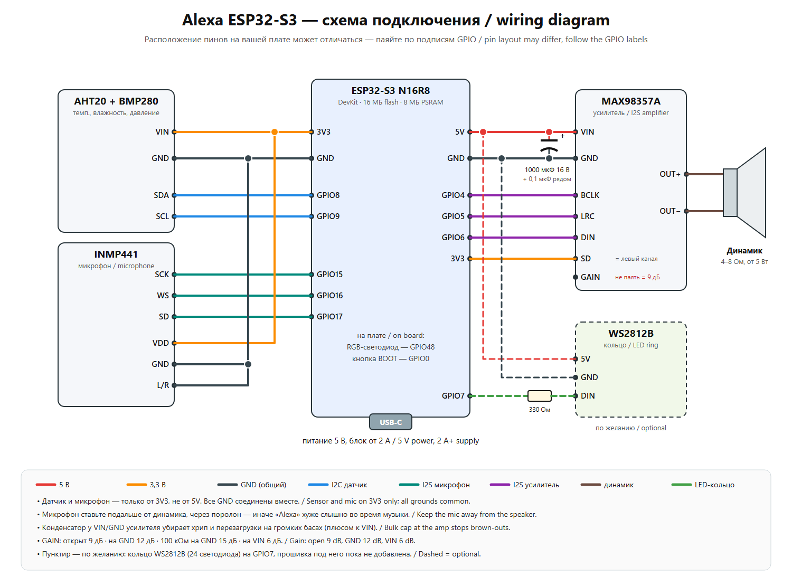

# 🔊 Alexa на ESP32-S3: умная колонка своими руками

[Українська версія](README.uk.md) · [English version](README.en.md)

Голосовая колонка на одной плате ESP32-S3. Говоришь «Alexa», задаёшь вопрос, и она отвечает голосом на русском. Сервер не нужен, всё работает на самой плате. Ещё она играет радио и Spotify, ставит будильники, измеряет температуру, влажность и давление, а управлять ею можно с сайта и из Telegram.

<!-- Сюда можно добавить фото:  -->

## Что умеет

- 🗣 **Голосовой ассистент.** Слово-активатор «Alexa» распознаётся прямо на плате (esp-sr). Дальше два режима:
  - **живой разговор через Gemini Live**: можно перебивать и уточнять;
  - **Groq** (Whisper + LLM) и голос Google Cloud TTS, с поиском в интернете.
- 🌦 **Метеостанция.** Датчики AHT20 и BMP280, графики за 14 дней, прогноз по давлению, погода Open-Meteo. Голосом предупреждает о сухом или влажном воздухе, холоде, жаре и падении давления.
- 📻 **Радио.** Список станций, поиск через radio-browser.info, громкость голосом.
- 🎵 **Spotify** через мост на ПК (Spotify Connect). Подробности ниже.
- ⏰ **Таймеры и будильники**, в том числе будильник с музыкой: после утренней сводки громкость плавно растёт.
- 🌙 **«Спокойной ночи».** Голос тише, светодиод выключен, музыка сама затихает по таймеру сна, утром режим выключается.
- 🌐 **Веб-страница** `http://meteo.local`: управление, настройки, графики, журнал, обновление прошивки.
- ✈ **Telegram-бот** прямо на плате, с кнопками: статус, музыка, громкость, ночь, «сказать вслух», вопрос ассистенту, обновление прошивки файлом. Работает из любой точки, ПК не нужен.
- 📶 **Настройка Wi-Fi с телефона.** Если колонка не нашла свою сеть, она создаёт точку **«Alexa-Setup»**. Подключись к ней и выбери сеть. Удобно, если колонку дарить.
- 🔄 **Обновление по воздуху**: через Arduino IDE, страницу `/update` или Telegram.

## Детали

| Деталь | Примечание |
|---|---|
| ESP32-S3 N16R8 DevKit | 16 МБ flash, 8 МБ PSRAM (обязательно OPI PSRAM) |
| MAX98357A | I2S-усилитель, питание 5 В |
| Динамик 4–8 Ом | от 5 Вт; MAX98357A отдаёт около 3 Вт |
| INMP441 | I2S-микрофон |
| AHT20 + BMP280 | модуль 2-в-1 на I2C |
| Конденсатор 1000 мкФ 16 В + 0,1 мкФ | на питание усилителя, против хрипа и перезагрузок |
| Блок питания USB 5 В от 2 А | |
| *Кольцо WS2812B (по желанию)* | на будущее, GPIO7 |

## Схема подключения



| Модуль | Пин модуля | ESP32-S3 |
|---|---|---|
| AHT20 + BMP280 | VIN / GND / SDA / SCL | 3V3 / GND / GPIO8 / GPIO9 |
| INMP441 | VDD / GND / SCK / WS / SD / L/R | 3V3 / GND / GPIO15 / GPIO16 / GPIO17 / GND |
| MAX98357A | VIN / GND / BCLK / LRC / DIN | 5V / GND / GPIO4 / GPIO5 / GPIO6 |
| MAX98357A | SD | 3V3 (левый канал) |
| MAX98357A | GAIN | не подключать (9 дБ) |
| Встроенный RGB-светодиод | | GPIO48 |
| Кнопка BOOT | | GPIO0: нажать, чтобы спросить; держать 10 с, чтобы настроить Wi-Fi |

Советы:
- Микрофон ставь подальше от динамика, лучше через поролон.
- Все GND соединяются вместе.
- Датчик и микрофон питаются только от 3V3.

## Прошивка

1. **Arduino IDE 2** и ядро **esp32 by Espressif** версии 3.x.
2. Библиотеки (из менеджера библиотек):
   - Adafruit AHTX0;
   - Adafruit BMP280 Library;
   - ArduinoJson;
   - ESP32-audioI2S (schreibfaul1).
3. Открой `aht20_bmp280/aht20_bmp280.ino`. Город для погоды по умолчанию Киев. Чтобы поставить свой, поменяй `WEATHER_LAT` и `WEATHER_LON` в `assistant.h` и слово «в Киеве» в подсказках `assistant.h` и `gemini_live.h`.
4. По желанию скопируй `secrets.example.h` в `secrets.h` и впиши свои Wi-Fi и пароли. Без него Wi-Fi настраивается через «Alexa-Setup». Стандартный пароль страницы `/update` — `admin` / `alexa`, его лучше поменять.
5. Настройки платы:
   - **ESP32S3 Dev Module**;
   - Flash Size **16MB**;
   - PSRAM **OPI PSRAM**;
   - USB CDC On Boot **Enabled**;
   - Partition Scheme **16M Flash (3MB APP/9.9MB FATFS)**. На самом деле берётся `partitions.csv` из папки скетча.
6. Первый раз прошивай **по USB-кабелю**.
7. Прошей модель слова «Alexa» `srmodels_alexa.bin`. Это делается один раз, инструкция в [README_wakeword.txt](aht20_bmp280/README_wakeword.txt).

Сборка из командной строки:

```bash
arduino-cli compile --fqbn "esp32:esp32:esp32s3:PSRAM=opi,FlashSize=16M,PartitionScheme=app3M_fat9M_16MB,CDCOnBoot=cdc" aht20_bmp280
```

## Первый запуск

1. Колонка создаёт сеть **Alexa-Setup**. Подключись к ней с телефона, выбери свою сеть и введи пароль.
2. Колонка скажет голосом, что подключилась. Открой `http://meteo.local`.
3. Во вкладке **⚙ Настройки** введи ключи. Они хранятся только в памяти платы, не в коде:
   - **Groq** (бесплатно, [console.groq.com](https://console.groq.com)): распознавание речи и ответы;
   - **Gemini API** ([aistudio.google.com](https://aistudio.google.com)): живой разговор. Подходит проект без оплаты;
   - **Google Cloud TTS** (по желанию): красивый голос. Месячный лимит в прошивке меньше бесплатного.
4. **Telegram:**
   - создай бота у [@BotFather](https://t.me/BotFather) и вставь токен на сайте;
   - отправь боту `/start` и шестизначный код с сайта.

## Spotify (по желанию, нужен ПК с Windows)

Папка `pc_bridge` устроена так:
- [Spotify Soloist](https://developer.spotify.com) (официальный клиент Spotify Connect) играет в виртуальный кабель [VB-CABLE](https://vb-audio.com/Cable/);
- скрипт `kolonka_bridge.py` кодирует звук в MP3 через ffmpeg и раздаёт поток колонке.

Как настроить:
1. Поставь Python 3, ffmpeg и VB-CABLE.
2. Скачай Soloist со страницы Spotify for Developers и положи его в `pc_bridge/soloist/`.
3. Положи свой личный ключ в `pc_bridge/soloist_key.txt`. Не выкладывай его никуда.
4. Запусти `start_bridge.bat`. Чтобы мост запускался вместе с Windows, запусти `autostart_on.bat`.
5. На сайте колонки укажи адрес потока `http://<IP ПК>:8000/spotify.mp3` и войди в Spotify.

Нужен Spotify Premium. Сборка Soloist действует 90 дней, потом её нужно скачать заново.

## Сброс перед подарком

`http://meteo.local/factory` стирает настройки, Wi-Fi и ключи. Привязку Telegram можно оставить. После сброса колонка снова создаёт сеть «Alexa-Setup».

## Лицензия

Код распространяется по лицензии [MIT](LICENSE). Файл `srmodels_alexa.bin` — модель wn9_alexa из [esp-sr](https://github.com/espressif/esp-sr) под лицензией ESPRESSIF MIT (только для чипов Espressif).
