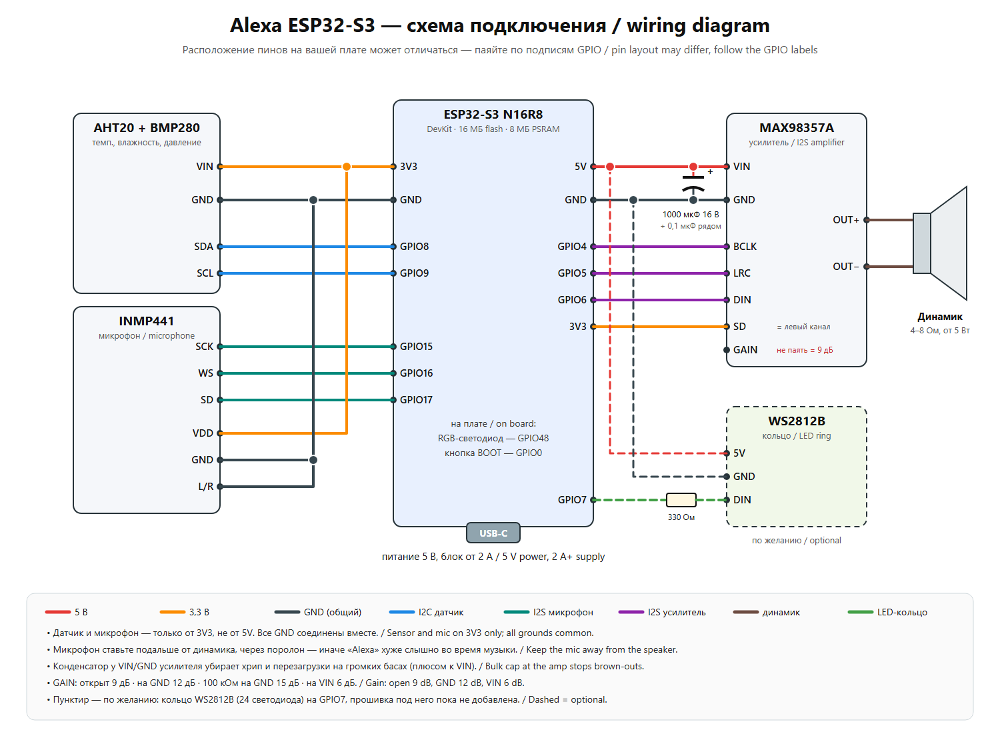

# 🔊 Alexa на ESP32-S3: розумна колонка своїми руками

[Русская версия](README.md) · [English version](README.en.md)

Голосова колонка на одній платі ESP32-S3. Кажеш «Alexa», ставиш питання, і вона відповідає голосом. Асистент за замовчуванням говорить російською; щоб змінити мову, достатньо змінити підказки. Сервер не потрібен, усе працює на самій платі. Ще вона грає радіо та Spotify, ставить будильники, вимірює температуру, вологість і тиск, а керувати нею можна із сайту та з Telegram.

<!-- Сюди можна додати фото:  -->

## Що вміє

- 🗣 **Голосовий асистент.** Слово-активатор «Alexa» розпізнається прямо на платі (esp-sr). Далі два режими:
  - **жива розмова через Gemini Live**: можна перебивати й уточнювати;
  - **Groq** (Whisper + LLM) і голос Google Cloud TTS, з пошуком в інтернеті.
- 🌦 **Метеостанція.** Датчики AHT20 і BMP280, графіки за 14 днів, прогноз за тиском, погода Open-Meteo. Голосом попереджає про сухе чи вологе повітря, холод, спеку та падіння тиску.
- 📻 **Радіо.** Список станцій, пошук через radio-browser.info, гучність голосом.
- 🎵 **Spotify** через міст на ПК (Spotify Connect). Подробиці нижче.
- ⏰ **Таймери й будильники**, зокрема будильник із музикою: після ранкового зведення гучність плавно зростає.
- 🌙 **«На добраніч».** Голос тихіший, світлодіод вимкнений, музика сама затихає за таймером сну, вранці режим вимикається.
- 🌐 **Веб-сторінка** `http://meteo.local`: керування, налаштування, графіки, журнал, оновлення прошивки.
- ✈ **Telegram-бот** прямо на платі, з кнопками: статус, музика, гучність, ніч, «сказати вголос», питання асистенту, оновлення прошивки файлом. Працює з будь-якого місця, ПК не потрібен.
- 📶 **Налаштування Wi-Fi з телефона.** Якщо колонка не знайшла свою мережу, вона створює точку **«Alexa-Setup»**. Підключись до неї та вибери мережу. Зручно, якщо колонку дарувати.
- 🔄 **Оновлення по повітрю**: через Arduino IDE, сторінку `/update` або Telegram.

## Деталі

| Деталь | Примітка |
|---|---|
| ESP32-S3 N16R8 DevKit | 16 МБ flash, 8 МБ PSRAM (обов'язково OPI PSRAM) |
| MAX98357A | I2S-підсилювач, живлення 5 В |
| Динамік 4–8 Ом | від 5 Вт; MAX98357A віддає близько 3 Вт |
| INMP441 | I2S-мікрофон |
| AHT20 + BMP280 | модуль 2-в-1 на I2C |
| Конденсатор 1000 мкФ 16 В + 0,1 мкФ | на живлення підсилювача, проти хрипу та перезавантажень |
| Блок живлення USB 5 В від 2 А | |
| *Кільце WS2812B (за бажанням)* | на майбутнє, GPIO7 |

## Схема підключення



| Модуль | Пін модуля | ESP32-S3 |
|---|---|---|
| AHT20 + BMP280 | VIN / GND / SDA / SCL | 3V3 / GND / GPIO8 / GPIO9 |
| INMP441 | VDD / GND / SCK / WS / SD / L/R | 3V3 / GND / GPIO15 / GPIO16 / GPIO17 / GND |
| MAX98357A | VIN / GND / BCLK / LRC / DIN | 5V / GND / GPIO4 / GPIO5 / GPIO6 |
| MAX98357A | SD | 3V3 (лівий канал) |
| MAX98357A | GAIN | не підключати (9 дБ) |
| Вбудований RGB-світлодіод | | GPIO48 |
| Кнопка BOOT | | GPIO0: натиснути, щоб запитати; тримати 10 с, щоб налаштувати Wi-Fi |

Поради:
- Мікрофон став подалі від динаміка, краще через поролон.
- Усі GND з'єднуються разом.
- Датчик і мікрофон живляться тільки від 3V3.

## Прошивка

1. **Arduino IDE 2** і ядро **esp32 by Espressif** версії 3.x.
2. Бібліотеки (з менеджера бібліотек):
   - Adafruit AHTX0;
   - Adafruit BMP280 Library;
   - ArduinoJson;
   - ESP32-audioI2S (schreibfaul1).
3. Відкрий `aht20_bmp280/aht20_bmp280.ino`. Місто для погоди за замовчуванням Київ. Щоб поставити своє, зміни `WEATHER_LAT` і `WEATHER_LON` в `assistant.h` та слово «в Киеве» в підказках `assistant.h` і `gemini_live.h`.
4. За бажанням скопіюй `secrets.example.h` у `secrets.h` і впиши свої Wi-Fi та паролі. Без нього Wi-Fi налаштовується через «Alexa-Setup». Стандартний пароль сторінки `/update` — `admin` / `alexa`, його краще змінити.
5. Налаштування плати:
   - **ESP32S3 Dev Module**;
   - Flash Size **16MB**;
   - PSRAM **OPI PSRAM**;
   - USB CDC On Boot **Enabled**;
   - Partition Scheme **16M Flash (3MB APP/9.9MB FATFS)**. Насправді береться `partitions.csv` з папки скетчу.
6. Перший раз прошивай **через USB-кабель**.
7. Проший модель слова «Alexa» `srmodels_alexa.bin`. Це робиться один раз, інструкція в [README_wakeword.txt](aht20_bmp280/README_wakeword.txt).

Збірка з командного рядка:

```bash
arduino-cli compile --fqbn "esp32:esp32:esp32s3:PSRAM=opi,FlashSize=16M,PartitionScheme=app3M_fat9M_16MB,CDCOnBoot=cdc" aht20_bmp280
```

## Перший запуск

1. Колонка створює мережу **Alexa-Setup**. Підключись до неї з телефона, вибери свою мережу та введи пароль.
2. Колонка скаже голосом, що підключилася. Відкрий `http://meteo.local`.
3. У вкладці **⚙ Налаштування** введи ключі. Вони зберігаються тільки в пам'яті плати, не в коді:
   - **Groq** (безкоштовно, [console.groq.com](https://console.groq.com)): розпізнавання мовлення та відповіді;
   - **Gemini API** ([aistudio.google.com](https://aistudio.google.com)): жива розмова. Підходить проєкт без оплати;
   - **Google Cloud TTS** (за бажанням): гарний голос. Місячний ліміт у прошивці менший за безкоштовний.
4. **Telegram:**
   - створи бота в [@BotFather](https://t.me/BotFather) і встав токен на сайті;
   - надішли боту `/start` і шестизначний код із сайту.

## Spotify (за бажанням, потрібен ПК з Windows)

Папка `pc_bridge` влаштована так:
- [Spotify Soloist](https://developer.spotify.com) (офіційний клієнт Spotify Connect) грає у віртуальний кабель [VB-CABLE](https://vb-audio.com/Cable/);
- скрипт `kolonka_bridge.py` кодує звук у MP3 через ffmpeg і роздає потік колонці.

Як налаштувати:
1. Встанови Python 3, ffmpeg і VB-CABLE.
2. Завантаж Soloist зі сторінки Spotify for Developers і поклади його в `pc_bridge/soloist/`.
3. Поклади свій особистий ключ у `pc_bridge/soloist_key.txt`. Нікуди його не викладай.
4. Запусти `start_bridge.bat`. Щоб міст запускався разом із Windows, запусти `autostart_on.bat`.
5. На сайті колонки вкажи адресу потоку `http://<IP ПК>:8000/spotify.mp3` і увійди в Spotify.

Потрібен Spotify Premium. Збірка Soloist діє 90 днів, потім її треба завантажити знову.

## Скидання перед подарунком

`http://meteo.local/factory` стирає налаштування, Wi-Fi і ключі. Прив'язку Telegram можна залишити. Після скидання колонка знову створює мережу «Alexa-Setup».

## Ліцензія

Код поширюється за ліцензією [MIT](LICENSE). Файл `srmodels_alexa.bin` — модель wn9_alexa з [esp-sr](https://github.com/espressif/esp-sr) під ліцензією ESPRESSIF MIT (тільки для чипів Espressif).
